# Data analysis scripts for Romand et al.

**"Guanosine tetraphosphate (ppGpp) promotes tolerance to excess light in *Arabidopsis thaliana*"**

This repository contains the R scripts used for the analyses in the manuscript, grouped by type of analysis, with example data for each script. Its purpose is analytical transparency and reuse.

**Version:** revised manuscript (2026). The scripts for the preprint version (2025) are tagged [`v1-preprint`](https://github.com/benfield99/Romand-et-al.-2025-analysis-scripts/tree/v1-preprint). The two scripts no longer used are also in `archive/`.

**Full datasets:** the complete raw and processed data, with one folder per figure panel, are archived in the French National Data Repository (Recherche Data Gouv): https://doi.org/10.57745/YZCG1W

---

## Repository structure

Each folder holds one family of scripts (scripts sharing the same analysis template). Each also has a `README.txt` describing the scripts, and an `example_data/` folder with real input data from the figures.

| Folder | Analysis |
|---|---|
| [`bleaching_ART/`](bleaching_ART) | Photobleaching (% of plant area) at one time point: median and bootstrap CI, aligned-ranks (ART) mixed model with experimental replicate as random effect |
| [`fvfm_ART/`](fvfm_ART) | Chlorophyll fluorescence (Fv/Fm, F0, Fm) of plants or detached leaves over time: normality test, then linear mixed model or ART ANOVA per time point, CLD letters; overlay plots of normalised values; data rebuilding from FluorCam exports |
| [`anova_bar/`](anova_bar) | Bar plots with one-way ANOVA + Tukey or Kruskal-Wallis + Dunn, chosen from a normality test on the ANOVA residuals; single-measure and multi-measure (e.g. pigments) versions |
| [`npq/`](npq) | NPQ kinetics from FluorCam exports, with mean or median and confidence intervals |
| [`spectra_77K/`](spectra_77K) | 77 K chlorophyll fluorescence spectra: qGAM fits, difference spectra vs wild type with simultaneous CIs, peak position and band-wise global p-values |
| [`archive/`](archive) | Scripts used for the preprint version but not for the revised manuscript |

---

## Gallery

Each thumbnail is the plot a script produces from its example data, before final layout for the figures. Click a thumbnail for the full-size image.

### bleaching_ART

<table>
<tr>
<td align="center"><a href="images/bleaching_ART_bleaching_ART.png">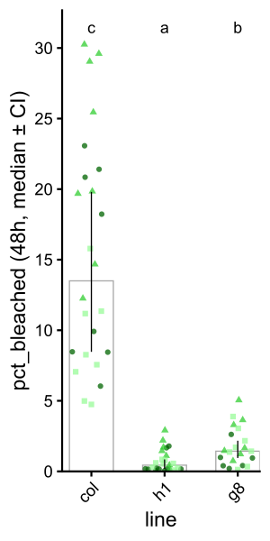</a> <code>bleaching_ART.r</code> Figs 1B, 2D</td>
<td align="center"><a href="images/bleaching_ART_bleach_panel_24h.png">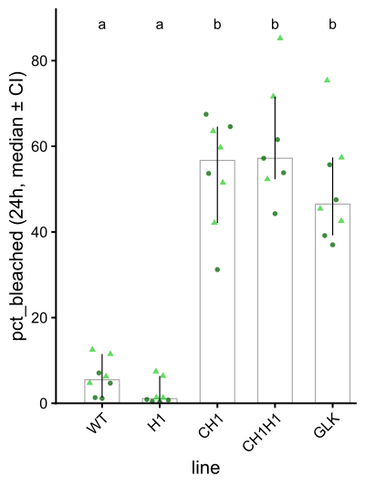</a> <code>bleach_panel_24h.r</code> Fig S7C</td>
</tr>
</table>

### fvfm_ART

<table>
<tr>
<td align="center"><a href="images/fvfm_ART_fvfm_detached_leaf_ART.png">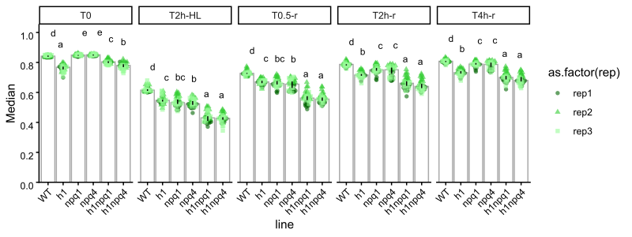</a> <code>fvfm_detached_leaf_ART.r</code> Figs 3C, S8B</td>
<td align="center"><a href="images/fvfm_ART_FvFm_overlays_spline.png">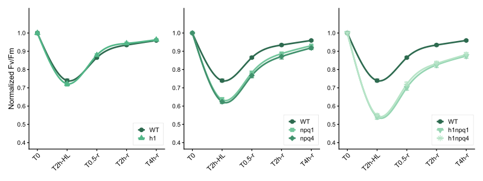</a> <code>FvFm_overlays_spline.R</code> Figs 3D, S8C</td>
</tr>
<tr>
<td align="center"><a href="images/fvfm_ART_fvfm_raw_and_normalised_ART.png">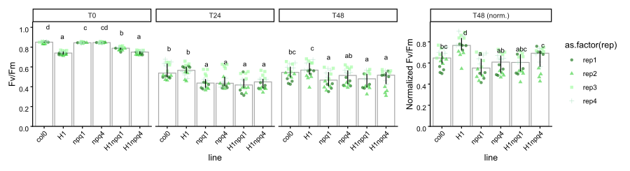</a> <code>fvfm_raw_and_normalised_ART.r</code> Figs 2E-F</td>
<td align="center"><a href="images/fvfm_ART_fvfm_T0_T24_raw_normalized.png">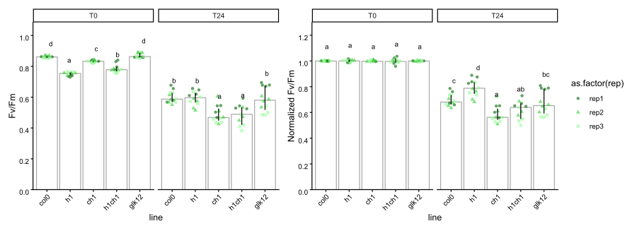</a> <code>fvfm_T0_T24_raw_normalized.r</code> Figs S7D-E</td>
</tr>
<tr>
<td align="center" colspan="2"><a href="images/fvfm_ART_fvfm_F0_Fm_detached_leaf_ART.png">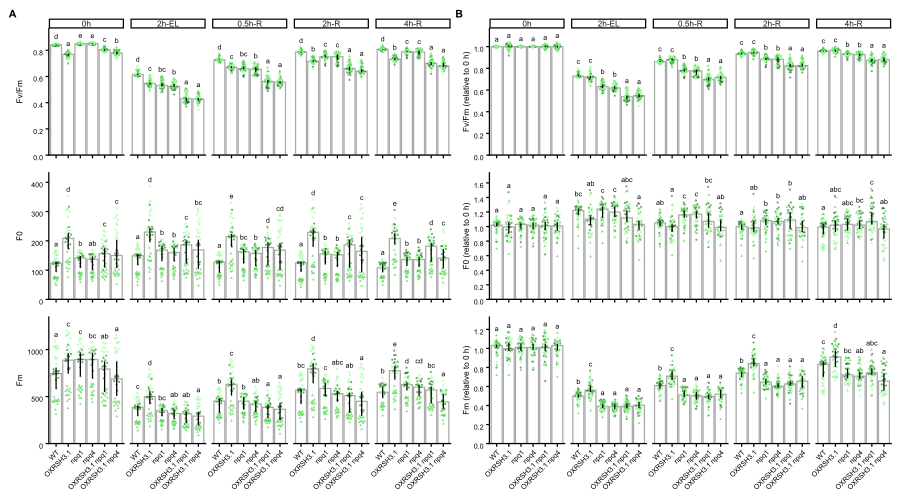</a> <code>fvfm_F0_Fm_detached_leaf_ART.r</code> + <code>combine_figure.R</code> Fig S6</td>
</tr>
</table>

### anova_bar

<table>
<tr>
<td align="center"><a href="images/anova_bar_ELIP2_anova.png">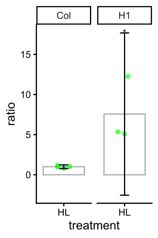</a> <code>ELIP2_anova.r</code> Fig 4B</td>
<td align="center"><a href="images/anova_bar_HOTE_anova.png">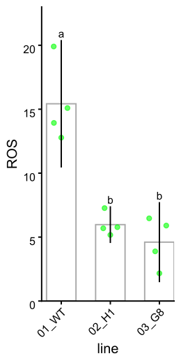</a> <code>HOTE_anova.r</code> Fig 1D</td>
<td align="center"><a href="images/anova_bar_ppGpp_anova.png">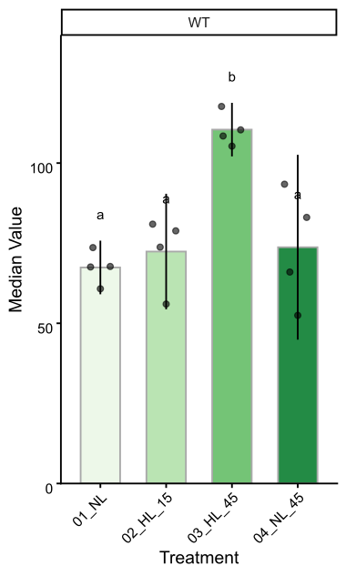</a> <code>ppGpp_anova.r</code> Fig 4E</td>
<td align="center"><a href="images/anova_bar_ppGpp_anova_extended.png">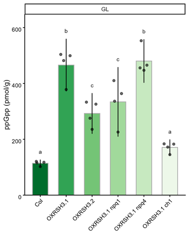</a> <code>ppGpp_anova_extended.r</code> Fig S1</td>
</tr>
<tr>
<td align="center" colspan="2"><a href="images/anova_bar_tocopherols_anova.png">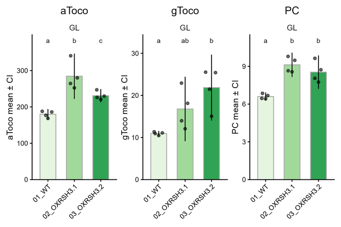</a> <code>tocopherols_anova.R</code> Fig 4C</td>
<td align="center" colspan="2"><a href="images/anova_bar_PSrates_anova.png">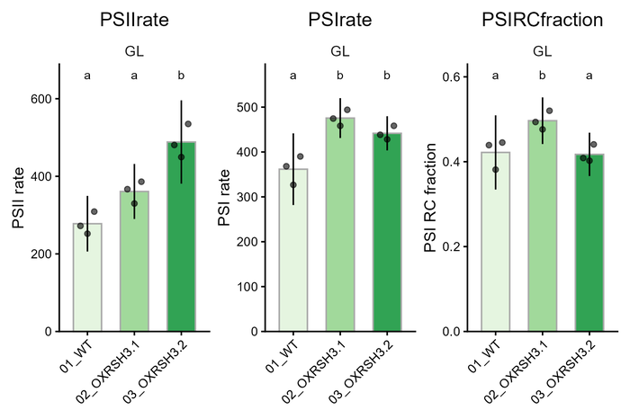</a> <code>PSrates_anova.R</code> Fig S3</td>
</tr>
<tr>
<td align="center" colspan="4"><a href="images/anova_bar_pigments_anova.png">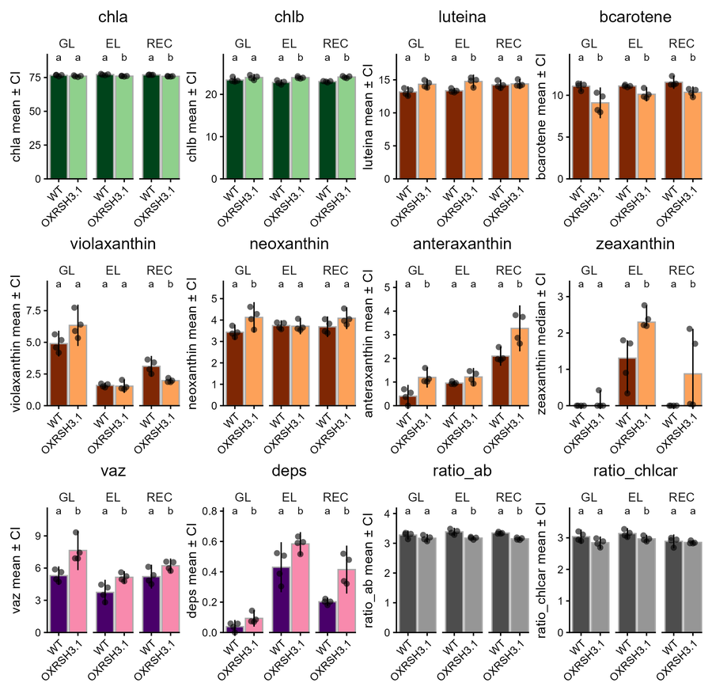</a> <code>pigments_anova.R</code> Figs S9, 4D</td>
</tr>
</table>

### npq and spectra_77K

<table>
<tr>
<td align="center"><a href="images/npq_script_npq.png">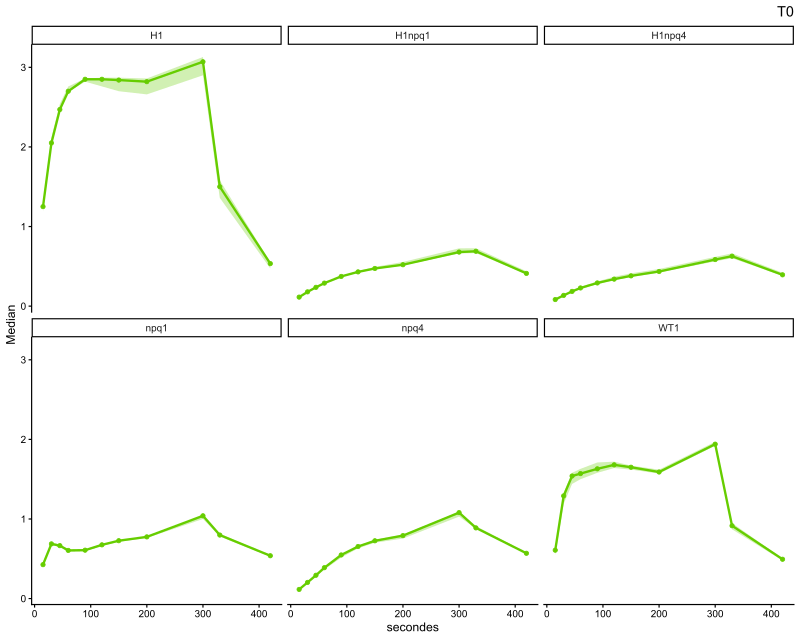</a> <code>script_npq.R</code> (one page per time point) Figs 1E, 2A, S5</td>
<td align="center"><a href="images/spectra_77K_qgam_median.png">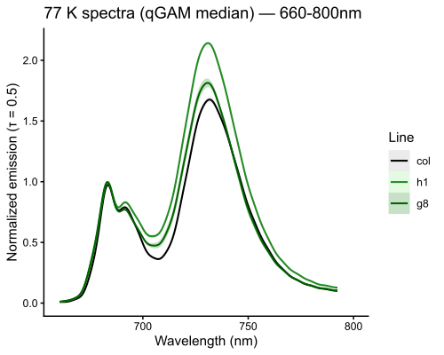</a> <code>script_77K_qgam.R</code>: fitted spectra Fig 1F</td>
<td align="center"><a href="images/spectra_77K_qgam_differences.png">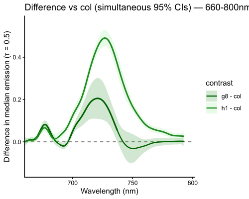</a> <code>script_77K_qgam.R</code>: difference spectra Fig 1H (same plot, 660-685 nm band)</td>
</tr>
</table>

---

## Script for each figure

| Figure | Script | Example data |
|---|---|---|
| 1B, 2D | `bleaching_ART/bleaching_ART.r` | `bleaching_ART/example_data/Fig1B` |
| S7C | `bleaching_ART/bleach_panel_24h.r` | `bleaching_ART/example_data/FigS7C` |
| 1D | `anova_bar/HOTE_anova.r` | `anova_bar/example_data/Fig1D` |
| 1E, 2A, S5 | `npq/script_npq.R` | `npq/example_data` |
| 1F-H | `spectra_77K/script_77K_qgam.R` | `spectra_77K/example_data` |
| 2E-F | `fvfm_ART/fvfm_raw_and_normalised_ART.r` | `fvfm_ART/example_data/Fig2EF` |
| 3C, S8B | `fvfm_ART/fvfm_detached_leaf_ART.r` | `fvfm_ART/example_data/Fig3CD_S6` |
| 3D, S8C | `fvfm_ART/FvFm_overlays_spline.R` | `fvfm_ART/example_data/Fig3CD_S6` |
| 4B | `anova_bar/ELIP2_anova.r` | `anova_bar/example_data/Fig4B` |
| 4C | `anova_bar/tocopherols_anova.R` | `anova_bar/example_data/Fig4C` |
| 4D, S9 | `anova_bar/pigments_anova.R` | `anova_bar/example_data/FigS9` |
| 4E | `anova_bar/ppGpp_anova.r` | `anova_bar/example_data/Fig4E` |
| S1 | `anova_bar/ppGpp_anova_extended.r` | `anova_bar/example_data/FigS1` |
| S3 | `anova_bar/PSrates_anova.R` | `anova_bar/example_data/FigS3` |
| S6 | `fvfm_ART/fvfm_F0_Fm_detached_leaf_ART.r`, `fvfm_ART/combine_figure.R`, `fvfm_ART/rebuild_combined_data.R` | `fvfm_ART/example_data/Fig3CD_S6` |
| S7D-E | `fvfm_ART/fvfm_T0_T24_raw_normalized.r` | `fvfm_ART/example_data/FigS7DE` |

Where one script serves several figures, the copies used for the other figures differ only in their settings block (line names, order, file names, plot size). The exact copy used for each panel is in the data repository.

---

## Usage

1. Clone or download this repository.
2. Copy the script into the folder that contains the input data (for example, its `example_data` folder), or put your own data, formatted like the example, in the same folder as the script.
3. Open the script in R or RStudio, and set the working directory to that folder.
4. Adjust the settings block at the top of the script if necessary: input file name, line names and order, time points, plot size.
5. Run the script. Most scripts install missing packages automatically.
6. Output tables and plots are written to the working directory, or to the output subfolder named in the script header.

Each script starts with a header giving:
- the figure(s) it was used for;
- its inputs and outputs;
- the statistical method.

Each family folder has a `README.txt` with more detail, including which parameters can be changed in the settings block at the top of each script and which are fixed in the code (column names, colours, output file names, plot sizes).

---

## Requirements

R ≥ 4.1

Packages used across the scripts:
ARTool, boot, cowplot, dplyr, emmeans, forcats, ggbeeswarm, ggplot2, lme4, MASS, matrixStats, multcomp, multcompView, patchwork, prospectr, purrr, qgam, rcompanion, readr, readxl, rlang, RColorBrewer, Rmisc, rstatix, scales, stringr, svglite, tidyr, tidyverse.

The scripts were tested with R 4.4.1 on the example data in this repository; their statistical outputs match those of the figures.

---

## Changes from the preprint version

- Scripts are grouped into family folders, each with its `README.txt` and example data from the figures.
- The scripts are the versions used for the revised manuscript. In the ANOVA-based scripts, normality is now tested on the pooled ANOVA residuals rather than group by group.
- Added:
  - bleaching ART scripts;
  - detached-leaf F0 and Fm analysis (version 8), with the figure-assembly and data-rebuilding scripts;
  - Fv/Fm overlay plots;
  - the two derived Fv/Fm scripts;
  - the multi-measure ANOVA scripts (tocopherols, PS rates);
  - a gallery of example plots.
- Moved to `archive/`: `script_QY_plot.R` and `script_PSrates.Rmd` (not used in the revised manuscript).

---

## License and citation

This repository is released under CC-BY 4.0.

If you use these scripts, please cite the associated manuscript and the dataset DOI.
